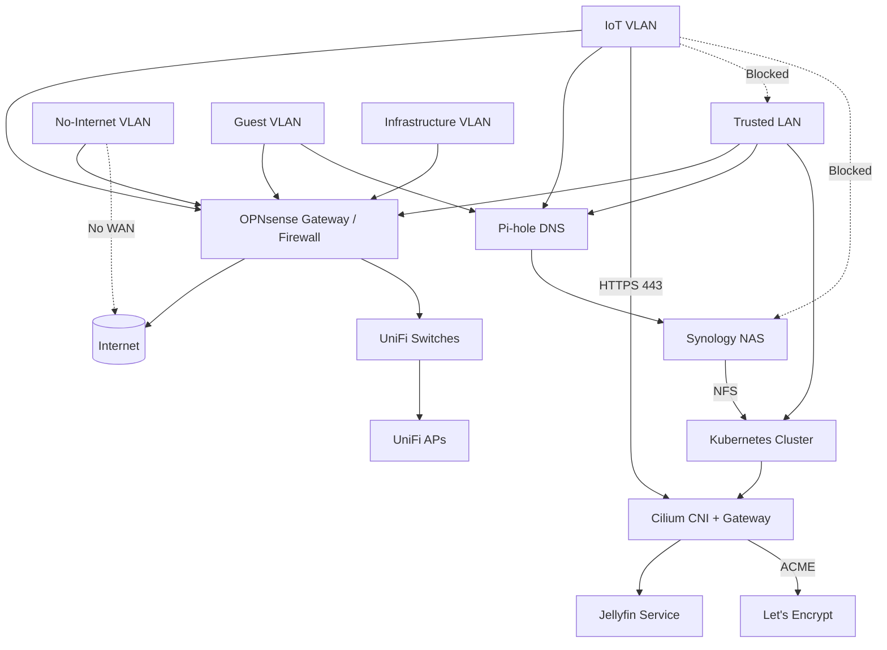

# Home Network Segmentation & Jellyfin Access Plan

> **Goal**: A segmented home network using OPNsense + UniFi + Kubernetes (Cilium) where Jellyfin is securely accessible to IoT (Roku) devices over HTTPS, while management and infrastructure services (e.g., UniFi) remain inaccessible to IoT.

---

## 1. High-Level Architecture

- **Gateway / Firewall**: OPNsense
- **Switching & Wi‑Fi**: UniFi switches and APs (self‑hosted UniFi controller)
- **DNS**: Pi‑hole (running on NAS)
- **Compute**: Kubernetes cluster with Cilium CNI + Gateway API
- **Media Service**: Jellyfin (running in Kubernetes)
- **Certificate Management**: cert‑manager + Let’s Encrypt

Key principle:
> **IP isolation first, TLS second** — certificates protect traffic, firewalling protects services.

---

## 2. Network Segments (Placeholders)

Replace the following placeholders with real values when implementing:

| Segment Name | Placeholder | CIDR Placeholder | Purpose |
|-------------|------------|------------------|---------|
| Trusted LAN | `<LAN_VLAN>` | `<LAN_CIDR>` | Personal devices, admin access |
| IoT | `<IOT_VLAN>` | `<IOT_CIDR>` | TVs, Roku, smart devices |
| No‑Internet | `<AIRGAP_VLAN>` | `<AIRGAP_CIDR>` | Devices with zero internet access |
| Guest | `<GUEST_VLAN>` | `<GUEST_CIDR>` | Guest devices |
| Work | `<WORK_VLAN>` | `<WORK_CIDR>` | Guest devices |
| Infrastructure | `<INFRA_VLAN>` | `<INFRA_CIDR>` | Router, switches, APs, monitoring |

---

## 3. Service Placement

### Jellyfin

- Runs inside Kubernetes
- Exposed via **Cilium Gateway**
- Assigned a **dedicated Gateway IP**: `<JELLYFIN_GW_IP>`
- HTTPS endpoint: `https://<JELLYFIN_FQDN>`

### UniFi Controller

- Runs on `<UNIFI_IP>`
- Accessible **only from Trusted LAN**
- Never shares IPs or gateways with Jellyfin

---

## 4. DNS Design (Pi‑hole)

Pi‑hole provides split‑horizon DNS and is enforced per VLAN.

### DNS Records

```text
<JELLYFIN_FQDN> → <JELLYFIN_GW_IP>
<UNIFI_FQDN>   → <UNIFI_IP>   (LAN only)
```

### Enforcement

- IoT VLAN DNS is forced to Pi‑hole
- Guest VLAN DNS is forced to Pi‑hole
- Optional: return NXDOMAIN for infra hostnames on IoT VLAN

---

## 5. Firewall Policy (Intent-Based)

### IoT VLAN (`<IOT_VLAN>`)

```text
ALLOW  <IOT_CIDR> → <JELLYFIN_GW_IP> : 443/tcp
ALLOW  <IOT_CIDR> → <PIHOLE_IP>      : 53/tcp,udp
ALLOW  <IOT_CIDR> → <NTP_IP>         : 123/udp
DENY   <IOT_CIDR> → <LAN_CIDR>       : any
DENY   <IOT_CIDR> → any              : default
```

### Trusted LAN (`<LAN_VLAN>`)

```text
ALLOW  <LAN_CIDR> → all VLANs        : admin‑initiated
```

### No‑Internet VLAN (`<AIRGAP_VLAN>`)

```text
DENY   <AIRGAP_CIDR> → WAN            : any
ALLOW  <LAN_CIDR>    → <AIRGAP_CIDR>  : admin‑only
```

---

## 6. mDNS / Discovery (Roku Requirement)

Roku devices require mDNS for Jellyfin discovery.

### Design

- mDNS **does not enter Kubernetes**
- OPNsense runs an mDNS reflector
- Reflection enabled only between:
  - `<LAN_VLAN>` ↔ `<IOT_VLAN>`

### Advertisement

- Advertise Jellyfin as:

```text
_jellyfin._tcp.local → <JELLYFIN_GW_IP>:443
```

UniFi settings:

- Disable "Block LAN to WLAN multicast" on IoT SSID
- Enable multicast enhancement (IGMP)
- Do not enable client isolation for IoT SSID

---

## 7. TLS & Certificates

### Certificate Strategy

- cert‑manager issues Let’s Encrypt certificates
- Preferred challenge: **DNS‑01**
- Alternative: HTTP‑01 (port 80 only on Jellyfin Gateway IP)

### Scope

- Certificates are issued **only** for `<JELLYFIN_FQDN>`
- UniFi and other services use separate IPs and certificates

> TLS protects Jellyfin traffic but does **not** expand network reachability.

---

## 8. Kubernetes / Cilium Notes

### Gateway

- Dedicated Gateway / GatewayClass for IoT‑exposed services
- Only Jellyfin routes are attached

### Network Policy (Placeholder)

```yaml
fromCIDR:
  - <IOT_CIDR>
toPorts:
  - port: "443"
    protocol: TCP
```

No Kubernetes service CIDRs are exposed directly to IoT.

---

## 9. Explicit Non‑Goals

- UniFi controller is **not** reachable from IoT
- Infrastructure services are **not** exposed via SNI‑only separation
- No shared IPs between unrelated services

---

## 10. Diagram-Friendly Variant (Mermaid)

The following diagram is intended for Markdown renderers that support Mermaid (e.g., GitHub, Obsidian, MkDocs).
It captures **network segmentation**, **service exposure**, and **storage relationships**.



---

## 11. Storage Design: NFS-backed Kubernetes StorageClass

- Synology NAS exports NFS from `<NAS_IP>`
- NFS is reachable **only** from:
  - Kubernetes node CIDR(s)
- NFS is **not** reachable from IoT, Guest, or WAN

### Intent

- Jellyfin media and metadata persist outside the cluster
- Storage survives node replacement
- NAS remains an infrastructure dependency, not an application endpoint

> The NAS is trusted infrastructure; access is explicit and one-directional.

---

## 12. Home Assistant & Matter (Kubernetes + IoT / Media VLANs)

Home Assistant requires **L2 adjacency** with device VLANs to support:

- mDNS-based discovery
- Matter commissioning and operation
- IPv6 + multicast traffic
- media-device discovery and control where those devices live outside IoT

This is intentionally handled **inside Kubernetes** using Multus.

---

### 12.1 Design Overview

- Home Assistant runs as a Kubernetes workload
- The pod is **multi-homed**:
  - **Primary interface**: Cilium (cluster / LAN-facing)
  - **Secondary interface**: Multus attachment on IoT VLAN
  - **Secondary interface**: Multus attachment on Media VLAN
- Home Assistant is treated as a **first-class device on those VLANs**, not infrastructure

No other workloads are allowed L2 access to the IoT or Media VLANs by default.

---

### 12.2 Multus Network Attachments

The repo keeps Kubernetes-side network declarations in
`kubernetes/apps/network-system/multus/config/`:

- `networkattachment-iot.yaml` declares `network-system/iot-vlan`
- `networkattachment-media.yaml` declares `network-system/media-vlan`

The Media VLAN attachment deliberately uses Flux substitution variables instead
of real topology values:

- `MEDIA_VLAN_ID` — VLAN ID used to form the host-side Talos VLAN interface
  `ethSel0.${MEDIA_VLAN_ID}`
- `MEDIA_CIDR` — Media VLAN CIDR used by Whereabouts
- `MEDIA_GATEWAY` — Media VLAN gateway address, excluded from allocation

Those values belong in `kubernetes/flux/vars/cluster-settings.sops.yaml`, matching
the existing IoT network substitutions. The host-side VLAN link must exist before
Home Assistant reconciles with the `media-vlan` attachment.

---

### 12.3 Home Assistant Pod Annotation

Home Assistant attaches both secondary networks through the Multus JSON
annotation:

```yaml
k8s.v1.cni.cncf.io/networks: |
  [
    { "name": "iot-vlan", "namespace": "network-system", "interface": "eth0.50" },
    { "name": "media-vlan", "namespace": "network-system", "interface": "eth0.${MEDIA_VLAN_ID}" }
  ]
```

With `MEDIA_VLAN_ID` set to the owner's Media VLAN ID, the pod-side name
renders as `eth0.<id>`. The VLAN attachment itself is selected by the NAD's
host-side `master` (`ethSel0.<id>`), not by the pod-side interface name.

This annotation is **exclusive** to Home Assistant.

### 12.3.1 Ordered cutover (owner)

Flux reconciles the full tracked HEAD, so two commits in one merge cannot
guarantee that Talos creates the host link before Home Assistant is restarted.
Apply Talos before merging the Kubernetes Media NAD and pod annotation. If
those manifests are already on the tracked branch, Home Assistant may fail
sandbox creation until Talos is updated; do not use a manual Kubernetes apply.

1. Set `data.mediaVlanId` in `talos/topf.yaml` to the Media VLAN ID. This
   Talos field stays plaintext like the existing `data.vlanId`; do not change
   the SOPS regex just to encrypt it. Use the matching encrypted
   `MEDIA_VLAN_ID`, `MEDIA_CIDR`, and `MEDIA_GATEWAY` in the
   `cluster-settings.sops.yaml` ConfigMap. Verify the switch trunk carries
   that VLAN on every node that may run Home Assistant.
2. Run `task talos:render`, then `task talos:diff node=<node>`. Compare actual
   node Talos/Kubernetes versions with `topf.yaml` first. Talos 1.13 rejects
   Kubernetes 1.37 images; at this cutover the nodes ran Kubernetes 1.36.4
   and the Talos v1.14 upgrade was waiting for its next maintenance window.
   Stop if the diff proposes unrelated image/version changes. On each
   eligible node, run
   `task talos:apply node=<node>` and confirm `ethSel0.<id>` exists and is up
   (`talosctl -n <node> get links`). No host address or default route should be
   added by this VLAN.
3. Once the host link exists on all eligible nodes, confirm Home Assistant is
   Ready and its Multus network-status annotation lists
   `network-system/media-vlan` on `eth0.<id>` with an address from the Media
   VLAN. If the steps run out of order, Multus cannot find its `master` on the
   node and Home Assistant fails pod sandbox creation.

This is an ordered one-time migration, not a new recurring reconciliation
loop. From-scratch rebuilds use the Talos template and the Flux manifests.

---

### 12.4 Routing & Hardening (Critical)

Home Assistant **must not** route traffic between interfaces.

Applied via initContainer or container entrypoint:

```bash
sysctl -w net.ipv4.ip_forward=0
sysctl -w net.ipv6.conf.all.forwarding=0
```

This ensures:

- Multi-homed ≠ router
- IoT VLAN cannot pivot into Kubernetes or LAN

---

### 12.5 Firewall Intent (IoT VLAN)

On OPNsense:

```text
ALLOW  <HA_IOT_IP> → <IOT_CIDR> : Matter, mDNS, required device protocols
DENY   <HA_IOT_IP> → <LAN_CIDR> : any
```

Home Assistant reaches LAN services **only** via its Cilium interface.

---

### 12.6 Kubernetes Network Policy (Optional but Recommended)

If enforcing Cilium policies:

```yaml
endpointSelector:
  matchLabels:
    app: home-assistant
egress:
- toCIDR:
  - <IOT_CIDR>
```

This prevents Home Assistant from becoming a lateral-movement pivot inside the cluster.

---

### 12.7 Matter-Specific Notes

Matter requires:

- Same L2 segment
- IPv6 enabled on IoT VLAN
- mDNS and multicast
- No NAT or L7 proxying

Implications:

- IPv6 Router Advertisements must reach the Multus interface
- mDNS reflectors are **not sufficient** for Matter
- Gateways and ingress controllers cannot replace L2 adjacency

---

## 13. Summary

- Segmentation is enforced at L3/L4 via OPNsense
- Jellyfin is the **only** IoT-reachable internal service via HTTPS
- Let’s Encrypt certificates do not weaken isolation
- mDNS is handled at the network edge (except where L2 is mandatory)
- Pi-hole runs on the Synology NAS and is authoritative DNS
- Synology NFS backs Kubernetes storage via a restricted StorageClass
- Home Assistant is **intentionally dual-homed** for Matter support
- Multus is scoped to a single workload with routing explicitly disabled

This design balances correctness, security, and operational reality without pretending Matter works at L3.
