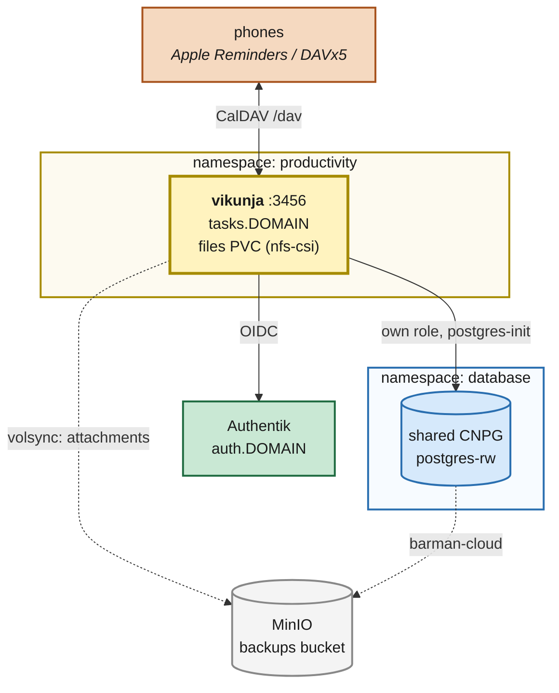

# Vikunja (tasks)

**Date:** 2026-09-07
**References:** <https://vikunja.io/docs/>

---

## Context

The household has nowhere to keep a shared, dated checklist. The immediate driver is trip
preparation — a packing list that is rebuilt from the same template every trip, alongside dated
pre-trip tasks like renewing a passport — but the gap is general.

**Vikunja** is the task manager: projects, tasks, due dates, labels, assignees, and a CalDAV
endpoint so each project appears as a list in the phones' native reminders apps. Project
duplication is what makes a reusable packing-list template possible.

It lands in the `productivity` namespace next to `mealie`, `paperless`, `wallos`, `forgejo`.

## Current State

- **Postgres**: one shared CNPG cluster at `postgres-rw.database.svc.cluster.local.`; apps get a
  database and an unprivileged role reconciled on every start by a `postgres-init` initContainer
  reading a Bitwarden-held credential (`paperless`, `forgejo`).
- **Storage**: dynamic `nfs-csi` for ordinary app data.
- **Backups**: `kubernetes/components/volsync` (restic → MinIO `backups`) per PVC; barman-cloud →
  MinIO `databases` for CNPG.
- **No SMTP.** Forgejo sets `ENABLE_NOTIFY_MAIL: false` with the comment "no SMTP anywhere in this
  cluster; fail closed rather than queue mail."
- **SSO**: `terraform/authentik/application_<app>.tf` + the `oidc_creds` module, which stores the
  client pair in Bitwarden as `authentik-client-<app>`.

## Target State

## Files Summary

| File | Purpose |
| --- | --- |
| `kubernetes/apps/productivity/vikunja/ks.yaml` | Flux Kustomization; volsync on `vikunja-files` |
| `…/vikunja/app/externalsecret.yaml` | pg role, JWT secret, and the OIDC `config.yml` |
| `…/vikunja/app/helmrelease.yaml` | app-template; `postgres-init` + `vikunja/vikunja` |
| `…/vikunja/app/kustomization.yaml` | wires the above + the guarded gatus template |
| `terraform/authentik/application_vikunja.tf` | OIDC provider + application + policy binding |

## Key Design Decisions

**D1 — Vikunja's OIDC provider arrives as a file, not as env vars.**
Vikunja will not accept a provider that exists only in the environment — the provider key must
be present in a config file first, and env vars can then only override fields on an existing
one. Rather than split the config across a ConfigMap and a Secret, the whole `auth:` block is
templated inside the `vikunja-config` ExternalSecret and mounted at `/etc/vikunja/config.yml`,
the same way paperless assembles its allauth provider JSON. The client secret never lands in Git.

**D2 — Notifications go over CalDAV, not email.**
There is no SMTP in this cluster, so `VIKUNJA_MAILER_ENABLED` is false: no email reminders, no
password resets. Reminders reach the phones by subscribing to `/dav` from Apple Reminders or
DAVx5, where the OS handles the notification. This is also the better packing UX — ticking an
item is one tap, offline, standing in front of a drawer.

**D3 — Local auth stays enabled.**
Vikunja keeps local auth enabled alongside OIDC, because it is also the only way to hand out a
plain CalDAV password if the token flow misbehaves.

## Owner Steps

These cannot be done from the repo — they need secrets or an interactive session.

1. **Bitwarden items** (all in the terraform-managed collection):
   - `vikunja pgcreds` — login item. Username + password: the Postgres role for Vikunja.
   - `vikunja credentials` — custom field `service_secret`: a long random string (JWT signing
     key). Write-once; rotating it invalidates every session and CalDAV token.
2. **Apply the Authentik terraform** (`terraform/authentik`) to create the provider. The
   `oidc_creds` module writes `authentik-client-vikunja` into Bitwarden itself; the
   ExternalSecret reads it from there.
3. **Build the packing template in Vikunja**: a project named e.g. `Packing — Template`, items
   as tasks, categories as labels. Duplicate it per trip from the project's ⋯ menu.
4. **Connect the phones**: Vikunja user settings → CalDAV tab → generate a token (OIDC accounts
   have no password to use), then point Apple Reminders / DAVx5 at
   `https://tasks.${SECRET_DOMAIN}/dav/principals/<username>/`.

## Verification

- `flate test all -p kubernetes/flux/config` passes (this is what CI runs).
- After reconcile: the Kustomization is Ready and the `vikunja` Deployment Available.
- `https://tasks.${SECRET_DOMAIN}` redirects to Authentik and lands back logged in. Gatus shows
  it green.
- Confirm the second household member can sign in — registration is disabled, so verify that
  an OIDC login still provisions their account rather than being refused.

## Risks

- **One failure domain for everything durable.** The NFS claim, the restic repository in MinIO,
  and the CNPG barman archive that backs Vikunja's task data are all on the same NAS export.
  Nothing added here changes that, and nothing here survives losing the array. The mitigation
  is an off-box backup at the NAS layer, not more ReplicationSources — see the correction in
  `2026-06-21-volsync-backups.md`.

## Rollback

Remove `./vikunja/ks.yaml` from `kubernetes/apps/productivity/kustomization.yaml` and let Flux
prune. The PVC is `retain: true`, so the data survives the prune and has to be deleted by hand
if that is actually what is wanted. The Postgres database and role Vikunja created on the
shared cluster also survive and would need dropping manually. Destroy the Authentik
application with terraform.
