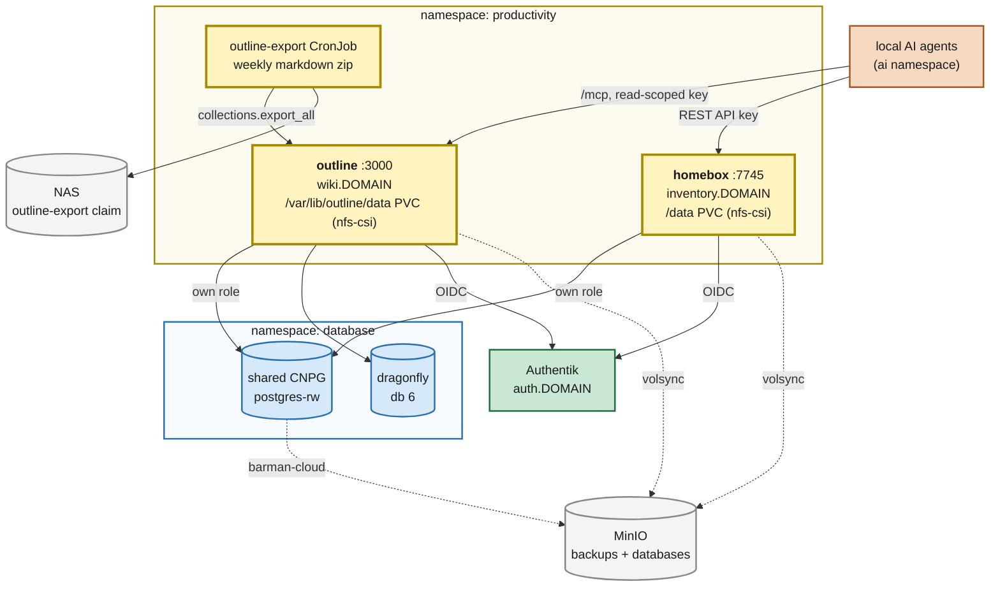

# Replace BookStack with Outline (knowledge) + Homebox (inventory)

**Date:** 2026-11-08
**Supersedes:** BookStack, deployed alongside Vikunja on 2026-09-07; its design notes were
removed from [`2026-09-07-vikunja.md`](2026-09-07-vikunja.md) and remain in git history.
**References:** <https://docs.getoutline.com/s/hosting> · <https://github.com/outline/outline> ·
<https://homebox.software> · <https://github.com/sysadminsmedia/homebox> ·
<https://github.com/pro4tlzz/eol-dr>

---

## Context

BookStack was deployed as the household wiki and never got any content. What it did get was
the only non-Postgres database engine in the cluster: BookStack is MySQL/MariaDB-only (upstream
declined Postgres because search is MySQL-specific), so it brought its own single MariaDB
instance on `openebs-hostpath` and a separate six-hourly logical-dump CronJob — a second backup
path to trust, alongside CNPG → MinIO for everything else.

The things the household actually needs documented:

1. **The house** — 20 appliances and 20 Z-Wave devices: model, serial, purchase date, warranty,
   manual, location, breaker.
2. **How things work** — network and naming conventions, troubleshooting (e.g. a Z-Wave
   switch whose paddle stops responding while the device still reports alive: pull the
   airgap tab, or flip its breaker).
3. **A handover for the spouse** in case something happens to the owner — readable and usable
   by a non-operator, and by AI agents acting on their behalf.

Those split cleanly into *facts* (structured, queryable, labelled) and *procedures* (prose).
One tool does each well; the wiki alone does facts badly (no "what warranties expire this
year", no labels).

- **Outline** — knowledge base. Postgres + Redis + file storage, all of which the cluster
  already runs and backs up; OIDC is env-var configured; best editor for an occasional,
  non-technical editor; ships an MCP endpoint for agents.
- **Homebox** — home inventory. Postgres-capable, env-var OIDC, QR/asset-ID labels, REST API
  with API keys.

Alternatives considered: Wiki.js (Postgres, built-in git sync — the best offline story, but its
2.x → 3.0 transition is unsettled and has no in-place upgrade), Docmost (SSO appears to be an
enterprise feature), git-backed markdown (no DB at all, but a poor editor for anyone but the
owner). Homebox was initially rejected as "one more bespoke app" and accepted once QR labels for
the spouse handover and warranty queries were on the table.

## Current State

- `kubernetes/apps/productivity/bookstack/` — BookStack (linuxserver image), `bookstack-mariadb`
  HelmRelease (app-template, datadir on `openebs-hostpath`), `db-dump.yaml` CronJob, one RWX
  `nfs-csi` claim (`bookstack-data`) for uploads + dumps, volsync on that claim,
  `GATUS_SUBDOMAIN: wiki`.
- `terraform/authentik/application_bookstack.tf` — provider/application/binding.
- `terraform/bitwarden/main.tf` — `bookstack credentials` (APP_KEY) and `bookstack dbcreds`.
- **BookStack holds no data** (confirmed by the owner, 2026-11-08). Nothing to export or
  archive.
- Shared infra used below: CNPG `postgres-rw.database.svc.cluster.local.` with the
  `postgres-init` initContainer pattern (mygarage, vikunja, paperless); dragonfly at
  `dragonfly.database.svc.cluster.local.:6379` with DB indexes 2–5 taken (paperless, forgejo)
  and `--default_lua_flags=allow-undeclared-keys` already set (needed by Bull-style queues);
  the `oidc_creds` module writing `authentik-client-<app>` into Bitwarden.

## Target State

**Division of content.** Homebox holds facts (one item per appliance/device; custom fields for
breaker, Z-Wave node ID, firmware, and the URL of its Outline page). Outline holds procedures
(one page per recurring task or failure mode, linking back to the Homebox item). Locations in
Homebox mirror rooms.

## Files Summary

| File | Change |
| --- | --- |
| `kubernetes/apps/productivity/bookstack/` | **Delete** (ks, HelmReleases, dump CronJob, PVC, ExternalSecrets) |
| `kubernetes/apps/productivity/outline/ks.yaml` | New — `GATUS_SUBDOMAIN: wiki`, volsync on `outline-data`, depends on external-secrets, cloudnative-pg-cluster, dragonfly, csi-driver-nfs |
| `kubernetes/apps/productivity/outline/app/helmrelease.yaml` | New — app-template, `outlinewiki/outline` pinned, `postgres-init` initContainer, internal ingress |
| `kubernetes/apps/productivity/outline/app/externalsecret.yaml` | New — `outline pgcreds` (DATABASE_URL + init vars), `outline credentials` (SECRET_KEY, UTILS_SECRET), `outline export` (admin API key), `authentik-client-outline` |
| `kubernetes/apps/productivity/outline/app/export-cronjob.yaml` | New — weekly `collections.export_all` → NAS claim |
| `kubernetes/apps/productivity/outline/app/export-pv.yaml` | New — static NFS PV + claim at `${SECRET_NFS_PATH}/outline-export`, so a person can find it on the NAS (dynamic claims land in `pvc-<uuid>`); not volsync'd — it *is* a copy |
| `kubernetes/apps/productivity/homebox/ks.yaml` | New — `GATUS_SUBDOMAIN: inventory`, volsync on `homebox-data` |
| `kubernetes/apps/productivity/homebox/app/{helmrelease,externalsecret,kustomization}.yaml` | New — `ghcr.io/sysadminsmedia/homebox` rootless variant pinned |
| `kubernetes/apps/productivity/kustomization.yaml` | Swap `bookstack` for `homebox` + `outline` |
| `kubernetes/apps/productivity/README.md` | Drop the BookStack row and the MariaDB exception paragraph; add both apps |
| `terraform/authentik/application_bookstack.tf` | **Delete** |
| `terraform/authentik/application_{outline,homebox}.tf` | New — same shape as `application_mygarage.tf` (`users` binding; RS256 signing key on Homebox only) |
| `terraform/bitwarden/main.tf` | Remove the two `bookstack` items; add `outline pgcreds`, `outline credentials`, `outline export` (`replace-me` sentinel + `ignore_changes`), `homebox pgcreds`, `homebox credentials` |
| `docs/plans/2026-09-07-vikunja-and-bookstack.md` | Renamed to `2026-09-07-vikunja.md`, BookStack content removed (it lives in git history) |

## Key Design Decisions

**D1 — Both apps on the shared CNPG cluster.** That is the whole point of the move: one database
engine, one backup path. Each gets its own database and unprivileged role via `postgres-init`,
exactly like mygarage. Homebox: `HBOX_DATABASE_DRIVER=postgres` plus `HBOX_DATABASE_{HOST,PORT,
USERNAME,PASSWORD,DATABASE,SSL_MODE}` (default `SSL_MODE` is `require`; CNPG serves TLS).
Outline: a single `DATABASE_URL`, assembled in the ExternalSecret template with `urlquery`
escaping, as mygarage does. No `sslmode`/`PGSSLMODE` is set: in production Outline connects
with TLS and `rejectUnauthorized: false` unless `PGSSLMODE=disable` (`server/storage/database.ts`,
checked at v1.12.0), which is what CNPG's self-signed server certificate needs. If a future
release starts verifying the certificate, the fix is mounting CNPG's CA, not disabling TLS. Outline runs its migrations on container start.

**D2 — Outline file storage is `local` on an `nfs-csi` claim, not MinIO.** Outline's S3 mode
uses presigned uploads: the *browser* uploads straight to the bucket, which means MinIO would
have to be reachable from every client with CORS for the wiki origin and public-access blocks
lifted. Local storage (`FILE_STORAGE=local`, `FILE_STORAGE_LOCAL_ROOT_DIR=/var/lib/outline/data`,
runs as uid 1001) on a volsync-backed claim is the house pattern and has none of that. Homebox
likewise uses its default `/data` (local `HBOX_STORAGE_CONN_STRING`); the rootless image runs as
65532.

**D3 — OIDC is fully declarative for both.** No UI step, unlike mygarage.
- Outline: `OIDC_ISSUER_URL=https://auth.${SECRET_DOMAIN}/application/o/outline-provider/`
  (discovery), `OIDC_CLIENT_ID`/`_SECRET` from `authentik-client-outline`, `OIDC_DISPLAY_NAME:
  Authentik`. Callback is `${URL}/auth/oidc.callback` (from `plugins/oidc/server/auth/
  oidcRouter.ts`). Outline has no password login, and email magic links need SMTP, which this
  cluster does not have — so OIDC is the only way in, which is fine.
- Homebox: `HBOX_OIDC_ENABLED=true`, `HBOX_OIDC_ISSUER_URL` (must match the discovery `issuer`
  exactly), client pair from `authentik-client-homebox`, `HBOX_OPTIONS_TRUST_PROXY=true`,
  `HBOX_OPTIONS_HOSTNAME=inventory.${SECRET_DOMAIN}` (hostname only, no scheme),
  `HBOX_OPTIONS_ALLOW_LOCAL_LOGIN=false`, `HBOX_OIDC_AUTO_REDIRECT=true`. Callback:
  `/api/v1/users/login/oidc/callback`.
- Only Homebox gets `signing_key` (RS256): it verifies the id_token with go-oidc, which
  rejects HS256. Outline only *decodes* the id_token for missing claims and never checks it
  against JWKS, so it keeps the HS256 default, per the "only where needed" rule in
  `terraform/authentik/main.tf`.
- Outline runs with `FORCE_HTTPS=false`: TLS terminates at the ingress, and the default
  would redirect the export CronJob's in-cluster http calls to https. `PROXY_HEADERS_TRUSTED=true` is set
  alongside it (Outline's default, made explicit) so the app trusts the ingress's
  `X-Forwarded-*` headers for scheme and client IP.

**D4 — Outline on dragonfly DB index 6.** `REDIS_URL: redis://dragonfly.database.svc.cluster.local.:6379/6`.
The lua flag Outline's queues need is already set cluster-wide.

**D5 — Secrets generated by `terraform/bitwarden`, never typed.** `outline credentials`:
`secret_key` and `utils_secret` (`random_id` 32 bytes, hex — Outline wants hex for
`SECRET_KEY`). `homebox credentials`: `api_key_pepper` (≥32 bytes; Homebox refuses to start
otherwise). Both are write-once: rotating Outline's `SECRET_KEY` invalidates sessions and
encrypted integration settings; rotating the Homebox pepper invalidates every issued API key.

**D6 — Weekly offline export of Outline to the NAS.** The spouse handover has to be readable
when the cluster is not, so a copy of the wiki must live outside it. `POST
/api/collections.export_all` with `format: outline-markdown, includeAttachments: true` starts an
async export (admin-only, rate-limited to 5/hour); the CronJob polls `fileOperations.info` and
downloads via `fileOperations.redirect` (a signed URL on the public origin, rewritten to the
in-cluster Service) into the `outline-export` static NFS path, keeping the last eight. It runs
on the Outline image itself (node has `fetch`), so there is no extra image to pin.
This recurs, so it is automated (per `CLAUDE.md`); the admin API key it uses is minted once in
Outline's UI (owner step) and pasted into Bitwarden `outline export` → `api_key`, over a
`replace-me` sentinel — the same pattern as `open-webui litellm`.
The NAS share is readable from any laptop without the cluster, and is what gets printed.

**D7 — Agents read through Outline's MCP endpoint with a scoped API key.** Outline mounts an MCP
server at `/mcp` accepting API-key, OAuth and MCP auth, gated by a workspace preference that
must be switched on. API keys carry scopes; agents get a read-scoped key first. Homebox's REST
API with an API key covers inventory lookups. The plain-markdown export (D6) is the fallback
agents can read with no running service at all.

**D8 — One merge, not two.** BookStack has no data, so there is no ordering constraint between
"new apps up" and "old app gone": nothing to export, nothing to protect on the MariaDB PVC.
The removal and the additions land together.

**D9 — Single replica, `Recreate`, RWO** for both, as is the house default.

## Cutover

1. `tofu apply` in `terraform/bitwarden` (new items; bookstack items destroyed).
2. `tofu apply` in `terraform/authentik` (new apps; bookstack app destroyed).
3. Merge. Flux prunes BookStack, MariaDB, the dump job and both PVCs (the openebs-hostpath PV
   goes with its claim), and brings up Outline and Homebox.
4. Owner steps below.

Order between 1–2 and 3 matters only in that the ExternalSecrets will sit unready until the
Bitwarden items exist; nothing is lost if they run out of order.

## Owner Steps

1. **Sign in to Outline first** — the first user creates the workspace and is admin. Then:
   - Settings → Security: restrict sign-in to the household domain/Authentik and turn **on**
     the MCP preference (D7).
   - Settings → API: mint an **admin** key for the export CronJob → Bitwarden
     `outline export` / `api_key` (overwrite `replace-me`; never delete the field). Mint a
     **read-scoped** key for agents when an agent is ready to use it — that wiring is not
     part of this change.
2. **Sign in to Homebox first.** Every user's first OIDC sign-in creates a fresh, empty "Home"
   group for them (`LoginOIDC` in `service_user.go`), so after the spouse's first sign-in,
   invite them into the owner's group from Homebox's UI.
3. **Create `<nfs-share>/outline-export` on the NAS**, writable by uid/gid 1001, before the
   first Sunday run (or trigger the CronJob by hand to test).
4. **Spouse signs in to both once**, so the accounts exist before they are needed.
5. **Populate**: Homebox locations = rooms; 20 appliances + 20 Z-Wave devices with breaker,
   node ID, manual PDF, and Outline-page URL fields. Outline: one collection for the house,
   one for the network/homelab, one for the handover (structured from the eol-dr checklist).
6. **Labels**: Homebox QR/asset-ID labels on appliances, each with the one critical line
   printed as text (the QR code is dead when the cluster is). Z-Wave switches get a single card
   at the breaker panel, not stickers on faceplates.
7. **Outside the repo, on purpose**: real network topology and credentials go in Bitwarden
   secure notes (with Emergency Access granted to the spouse), not in Outline's export path
   unless that NAS share is access-controlled, and never in this repo. Print the handover
   yearly from the NAS export.
8. Optionally prune the old `volsync/bookstack` restic repository in MinIO.

## Verification

- `flate test all -p kubernetes/flux/config`, `yamllint .`, `pre-commit run --all-files` pass.
- After reconcile: `cluster-apps-outline` and `cluster-apps-homebox` Ready; no
  `cluster-apps-bookstack`; no `bookstack-*` PVCs left in `productivity`.
- `init-db` exits 0 for both; `\l` on the shared cluster shows `outline` and `homebox`.
- `https://wiki.${SECRET_DOMAIN}` and `https://inventory.${SECRET_DOMAIN}` redirect to
  Authentik and land logged in; Gatus guarded pairs green for both.
- Homebox local login form is absent (`ALLOW_LOCAL_LOGIN=false` took effect).
- A manual run of the export CronJob leaves a markdown zip on the NAS claim that opens on a
  laptop with images intact.
- An agent with the read-scoped key can list documents over `/mcp` and cannot edit one.
- First hourly volsync snapshots exist for `outline-data` and `homebox-data`.

## Risks

- **Postgres and file claims restore separately.** Attachments rows point at files on the
  claims; restoring one from a much older snapshot than the other gives broken links, not an
  error. Same caveat as mygarage.
- **Outline is BSL 1.1.** Fine for household use; it would matter only if this were ever offered
  as a service.
- **The export key is an admin key** sitting in a CronJob's Secret. Acceptable on an internal
  cluster; rotate it if the CronJob is ever retired.
- **The NAS export is plain text of the handover.** If the handover ends up containing anything
  sensitive, the NAS share's access control is what protects it — keep credentials in Bitwarden
  and reference them by item name instead.
- **Homebox gives each new OIDC user their own group**, so a household member who skips the
  invite ends up with a private, empty inventory rather than an error. Owner step 2.
- **Single Zooz stick node** remains a single point of failure for all Z-Wave automation; it
  belongs in the handover, not in this change.
