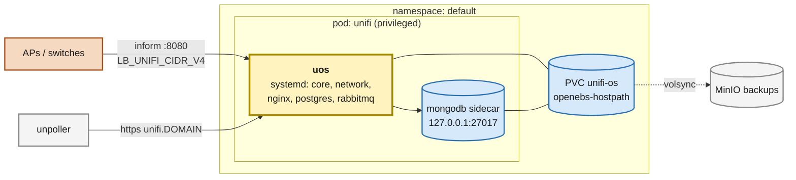

# UniFi Network Application → UniFi OS Server

**Date:** 2026-11-22
**References:**
- <https://github.com/unihosted/unifi-os-server-docker> (image, entrypoint, compose)
- <https://help.ui.com/hc/en-us/articles/34210126298775-Self-Hosting-UniFi>
- <https://www.unihosted.com/docs/migrate-unifi-network-application-to-unifi-os-server>

---

## Context

Ubiquiti now calls the standalone UniFi Network Application "legacy" and is moving self-hosted
installs to **UniFi OS Server** (UOS). UOS is the UniFi OS platform from their gateways, packaged
to self-host, with Network as one module inside it. Network 11 is built for UOS. No end-of-support
date has been announced for the legacy app. The controller UI now shows an upgrade nag.

The current controller is already a community image (`jacobalberty/unifi`), so changing to a
community UOS image doesn't add trust risk. What changes is the shape of the workload. UOS isn't
one Java process. It is a systemd-managed bundle (UniFi Core, Network, nginx, PostgreSQL 14,
RabbitMQ, …), and the data has to be migrated by backup and restore, not upgraded in place.

Upstream chosen: **unihosted/unifi-os-server-docker**. It tags images per UOS version
(`5.1.42`, plus `-amd64`/`-arm64` variants) and applies CVE workarounds in its own images. lemker's
image only documents `:latest`.

## Current State

- `kubernetes/apps/default/unifi/`: app-template 3.7.3, `jacobalberty/unifi:v10.0.162`,
  StatefulSet, runs as UID 999.
- Data: app-template persistence `config` → PVC **`unifi-config`** (20Gi, `nfs-csi`), mounted at
  `/unifi`. MongoDB lives inside it.
- Backups: `components/volsync` (`APP: unifi`, `VOLSYNC_CLAIM: unifi-config`, PUID/PGID 0).
- Service `unifi`: LoadBalancer on `${LB_UNIFI_CIDR_V4}`. Ports: 8443 GUI, 8080 inform, 6789,
  3478/udp, 5514/udp, 10001/udp. Devices inform to that LB IP on 8080.
- Ingress `unifi.${SECRET_DOMAIN}` (class `internal`, HTTPS backend → 8443).
- Gatus probes `/manage/account/login`. unpoller (`observability`) logs in to
  `https://unifi.${SECRET_DOMAIN}` with `${SECRET_UNPOLLER_USER}`/`${SECRET_UNPOLLER_PASS}`.

## Target State



Same app directory, same HelmRelease name (`unifi`), same Service name and LB IP, same hostname.
Only the workload, the PVC, and the probe and policy details change.

## Key Design Decisions

- **Replace in place, don't run the two side by side.** The devices inform to one LB IP and only
  one Service can hold it. Downtime is fine, and the devices keep forwarding traffic while the
  controller is away.
- **`privileged: true`.** systemd needs a writable cgroup tree. The compose file uses
  `cgroup: host` + a `/sys/fs/cgroup` rw bind + `NET_RAW`/`NET_ADMIN`. Kubernetes has no cgroupns
  knob, and an rw hostPath of the host cgroup root isn't meaningfully safer than privileged.
  Privileged under containerd's private cgroup namespace gives systemd its own writable subtree
  and leaves the host's alone. Trade-off: a privileged pod on the network controller. Accepted for
  a home lab, and flagged for revisiting if upstream ships a rootless mode.
- **External MongoDB as a sidecar (`MONGO_INTERNAL: "false"`), bound to 127.0.0.1.** This is
  upstream's default and the configuration they test. `mongo:4.4` matches their compose. It is
  EOL, but upgrading Mongo is a separate change. Fallback: `MONGO_INTERNAL: "true"` uses the
  Network app's bundled mongod (port 27117) and drops the sidecar.
- **`openebs-hostpath`, not `nfs-csi`.** The pod now holds three databases: Mongo, Postgres and
  RabbitMQ. The entrypoint also `chown -R`s data dirs as root. NFS locking and fsync semantics are
  the wrong place for that. Trade-off: the claim is pinned to one node. If that node is lost,
  restore from VolSync or from the `.unf` autobackup. That's acceptable here.
- **CiliumNetworkPolicy, ingress restricted to service ports.** The entrypoint rewrites
  `pg_hba.conf` to `host all all 0.0.0.0/0 trust` and sets `listen_addresses = '*'`. That is
  meant for Docker port mapping. In a pod it means **any pod in the cluster** can reach an
  unauthenticated Postgres (and Mongo, RabbitMQ) on the pod IP. The policy only admits the ports
  the Service exposes. Egress stays open, because firmware downloads, the UI cloud and STUN need it.
- **Reuse the VolSync `APP: unifi` repo, repointed at `unifi-os`.** The ReplicationSource name and
  restic path stay the same. The old controller's snapshots age out under the existing retention
  (24 hourly / 7 daily). Old data stays recoverable because the old PVC is retained (Merge A)
  and the `.unf` is kept off-cluster (step 0) until the old PVC is deleted.
  VolSync copies live DB files, so treat it as crash-consistent at best. The authoritative restore
  artefact is UniFi's own `.unf` autobackup, which lives inside the PVC and is backed up with it.

## Files Summary

| File | Merge | Change |
|---|---|---|
| `kubernetes/apps/default/unifi/app/helmrelease.yaml` | A | `retain: true` on `persistence.config` |
| `kubernetes/apps/default/unifi/app/helmrelease.yaml` | B | rewritten for UOS (draft below) |
| `kubernetes/apps/default/unifi/app/pvc.yaml` | B | new `unifi-os` claim |
| `kubernetes/apps/default/unifi/app/networkpolicy.yaml` | B | new |
| `kubernetes/apps/default/unifi/app/kustomization.yaml` | B | add `pvc.yaml`, `networkpolicy.yaml` |
| `kubernetes/apps/default/unifi/app/gatus.yaml` | B | URL `/manage/account/login` → `/` |
| `kubernetes/apps/default/unifi/ks.yaml` | B | `VOLSYNC_CLAIM: unifi-os`, `VOLSYNC_STORAGECLASS: openebs-hostpath`, `timeout: 10m` |
| `kubernetes/apps/default/README.md` | B | link → unihosted |

## Cutover (ordered — two merges, owner verifies in between)

**Why the order matters:** Merge B removes `persistence.config` from the release. Without
`helm.sh/resource-policy: keep` already on the **live** `unifi-config` PVC, Helm deletes it during
that upgrade. That deletion takes the only on-cluster copy of the old controller with it. The
annotation is read from the live object, so it has to be in the cluster before B lands. Two
commits in one merge don't count as ordering.

0. **Owner: take a backup off-cluster.** Old UI → Settings → System → Backups → Download (choose
   the longest history you care about). Keep the `.unf` on your workstation. Note the Network
   version (10.0.162). Check that UOS 5.1.42's bundled Network is the same or newer, because
   restores don't go backwards.
1. **Merge A:** add `retain: true` under `persistence.config`.
   **Verify:** `kubectl -n default get pvc unifi-config -o jsonpath='{.metadata.annotations}'`
   shows `"helm.sh/resource-policy":"keep"`. Don't merge B until it does.
2. **Merge B:** the UOS release, PVC, policy, gatus and ks changes.
   **Verify:**
   - Pod `Running` 2/2. `kubectl logs` shows "Starting systemd init" and does **not** show
     "Creating eth0 macvlan alias". The pod's veth `eth0` sits under `/sys/devices/virtual/net`,
     so that branch should be skipped. If it runs, stop and investigate.
   - `kubectl -n default get pvc unifi-config` still exists.
   - `https://unifi.${SECRET_DOMAIN}` loads the UOS setup wizard.
3. **Owner: set up and restore.** Finish the wizard (owner account), then restore the `.unf` from
   UniFi Network → Settings → System → Backups (or the wizard's restore option).
   **Verify:** every AP and switch shows Online without re-adoption. The inform URL is unchanged
   because `UOS_SYSTEM_IP` is the same LB IP. Clients are visible and settings look right.
   If devices stay Disconnected, SSH to one and run `set-inform http://<LB IP>:8080/inform`.
4. **Owner: recreate the unpoller user** in UOS → Admins & Users as a local-only account with a
   View-Only Network role, reusing the existing `SECRET_UNPOLLER_USER`/`SECRET_UNPOLLER_PASS`.
   A Network `.unf` restore doesn't recreate UniFi OS logins. **Verify:** the Grafana UniFi
   dashboards populate again.
5. **Owner: check durability.** The next hourly VolSync run of `unifi` succeeds against
   `unifi-os`. Find where UOS writes Network autobackups (expected under the `uos` subPath,
   `/var/lib/unifi/backup/autobackup`) and confirm one appears. Update this doc with the real path.
6. **Owner, irreversible, later:** after a couple of weeks of normal operation, delete the
   `unifi-config` PVC (and its PV, if the reclaim policy is Retain). Nothing in Git refers to it,
   so deleting it makes the cluster match the repo. A from-scratch rebuild reaches the same state
   without steps 0–6, starting from the wizard and a `.unf` restore.

## HelmRelease draft (Merge B)

Only `values` changes. Everything above it (chart 3.7.3, intervals, remediation) stays as is.

```yaml
  values:
    controllers:
      main:
        type: deployment
        strategy: Recreate
        pod:
          # STOPSIGNAL is SIGRTMIN+3 (systemd halt); give the DBs time to shut down cleanly.
          terminationGracePeriodSeconds: 120
        containers:
          main:
            image:
              repository: ghcr.io/unihosted/unifi-os-server-docker
              tag: 5.1.42
              pullPolicy: IfNotPresent
            env:
              TZ: America/New_York
              # What devices are told to inform to — must be the LB IP, not the ingress host.
              UOS_SYSTEM_IP: ${LB_UNIFI_CIDR_V4:=192.168.1.1}
              UOS_LOG_FORMAT: text
              MONGO_INTERNAL: "false"
              MONGO_HOST: 127.0.0.1
              MONGO_PORT: "27017"
            securityContext:
              # systemd needs a writable cgroup tree; see plan doc for why not hostPath cgroup.
              privileged: true
            probes:
              startup:
                enabled: true
                custom: true
                spec:
                  tcpSocket:
                    port: 443
                  periodSeconds: 10
                  failureThreshold: 60   # systemd + Core + Network can take minutes
              liveness:
                enabled: true
                custom: true
                spec:
                  tcpSocket:
                    port: 443
              readiness:
                enabled: true
                custom: true
                spec:
                  tcpSocket:
                    port: 443
            resources:
              requests:
                cpu: 100m
                memory: 2Gi
              limits:
                memory: 4Gi
          mongodb:
            image:
              repository: docker.io/library/mongo
              tag: 4.4.29
            # same pod network namespace — keep it off the pod IP
            args: ["--bind_ip", "127.0.0.1"]
            resources:
              requests:
                cpu: 20m
                memory: 256Mi
              limits:
                memory: 1Gi
    service:
      main:
        controller: main
        type: LoadBalancer
        externalTrafficPolicy: Cluster
        loadBalancerIP: ${LB_UNIFI_CIDR_V4:=192.168.1.1}
        ports:
          http:
            port: 443
            protocol: HTTPS
          controller-api:
            port: 8443
            protocol: HTTPS
          inform:
            port: 8080
            protocol: TCP
          speedtest:
            port: 6789
            protocol: TCP
          stun:
            port: 3478
            protocol: UDP
          syslog:
            port: 5514
            protocol: UDP
          discovery:
            port: 10003
            protocol: UDP
    ingress:
      main:
        enabled: true
        className: internal
        annotations:
          nginx.ingress.kubernetes.io/backend-protocol: "HTTPS"
          hajimari.io/icon: mdi:lan
        hosts:
          - host: &host "unifi.${SECRET_DOMAIN:=internal}"
            paths:
              - path: /
                service:
                  identifier: main
                  port: http
        tls:
          - hosts:
              - *host
            secretName: wildcard-cert-tls
    persistence:
      data:
        existingClaim: unifi-os
        advancedMounts:
          main:
            main:
              # upstream compose mounts the same dir at both paths
              - path: /var/lib/uosserver
                subPath: uos
              - path: /var/lib/unifi
                subPath: uos
              - path: /data
                subPath: data
            mongodb:
              - path: /data/db
                subPath: mongodb
      # tmpfs set from upstream compose
      run:
        type: emptyDir
        medium: Memory
        advancedMounts: {main: {main: [{path: /run}]}}
      run-lock:
        type: emptyDir
        medium: Memory
        advancedMounts: {main: {main: [{path: /run/lock}]}}
      tmp:
        type: emptyDir
        medium: Memory
        advancedMounts: {main: {main: [{path: /tmp}]}}
      journal:
        type: emptyDir
        medium: Memory
        advancedMounts: {main: {main: [{path: /var/log/journal}]}}
      unifi-tmp:
        type: emptyDir
        medium: Memory
        sizeLimit: 64Mi
        advancedMounts: {main: {main: [{path: /var/opt/unifi/tmp}]}}
      core-http:
        type: emptyDir
        medium: Memory
        advancedMounts: {main: {main: [{path: /data/unifi-core/config/http}]}}
```

`pvc.yaml`:

```yaml
---
apiVersion: v1
kind: PersistentVolumeClaim
metadata:
  name: unifi-os
  labels:
    kustomize.toolkit.fluxcd.io/prune: disabled
spec:
  accessModes: [ReadWriteOnce]
  storageClassName: openebs-hostpath
  resources:
    requests:
      storage: 20Gi
```

`networkpolicy.yaml`:

```yaml
---
# The UOS entrypoint opens Postgres to 0.0.0.0/0 with trust auth (meant for Docker port
# mapping), and RabbitMQ/Mongo also listen in the pod. Reachability is the only access
# control, so admit just the ports the Service exposes. Probes, LB and ingress traffic
# all land on those ports. Egress is open: firmware, UI cloud, STUN.
apiVersion: cilium.io/v2
kind: CiliumNetworkPolicy
metadata:
  name: unifi-service-ports-only
  namespace: default
spec:
  endpointSelector:
    matchLabels:
      app.kubernetes.io/name: unifi
  ingress:
    - fromEntities:
        - all
      toPorts:
        - ports:
            - {port: "443", protocol: TCP}
            - {port: "8443", protocol: TCP}
            - {port: "8080", protocol: TCP}
            - {port: "6789", protocol: TCP}
            - {port: "3478", protocol: UDP}
            - {port: "5514", protocol: UDP}
            - {port: "10003", protocol: UDP}
```

Merge A is a single line in the current release:

```yaml
    persistence:
      config:
        enabled: true
        retain: true   # keep unifi-config through the UOS cutover (docs/plans/2026-11-22-unifi-os-server.md)
```

## Owner Steps

Collected from the cutover above. None of them needs a new secret or substitution variable.

1. Download the `.unf` off-cluster and confirm the restore version is compatible (step 0).
2. Verify the keep annotation between Merge A and Merge B (step 1).
3. Finish the UOS wizard and restore the `.unf` (step 3).
4. Recreate the unpoller login in UOS (step 4).
5. Confirm VolSync and autobackups, and record the autobackup path here (step 5).
6. Delete the `unifi-config` PVC once satisfied (step 6, irreversible).

## Verification

- `task k8s:flate` passes for both merges.
- The per-step checks in the cutover section.
- Gatus `unifi` turns green on `/` after Merge B. If UOS answers `/` with a redirect rather than a
  200, change the condition or point it at the login path the UI actually uses.

## Risks / Open Questions

- **Does the setup wizard require a UI.com account?** Unknown. If it does, that's a one-off owner
  step, not something to automate.
- **Privileged pod**, accepted above. Revisit if upstream supports an unprivileged mode.
- **Single small upstream**: unihosted, about 10 releases in 2026, irregular cadence. Ubiquiti
  security fixes reach us only when they rebuild. Renovate tracks the plain semver tags. The
  `-amd64`/`-arm64` suffixed tags count as different "compatibility" and won't be proposed.
- **`mongo:4.4` is EOL.** It matches upstream's tested compose. Moving to a supported Mongo, or to
  `MONGO_INTERNAL: "true"`, is a follow-up.
- **Node-pinned storage**: losing the node means restoring, which is acceptable for this cluster.
- **unpoller compatibility**: it supports UniFi OS consoles. If it can't log in through the
  ingress, try `controller-api` (8443) on the LB IP.

## Rollback

Possible until step 6. Revert Merge B. The old release re-renders `persistence.config`, Helm
picks up the retained `unifi-config` PVC (it still carries the release's ownership metadata),
and the old controller starts with the data it had before the cutover. The devices keep the
same inform IP and authkey, so they should reconnect. Any config changed in UOS after the
cutover is lost. The `unifi-os` PVC is `prune: disabled`, so delete it by hand if it isn't
wanted.
